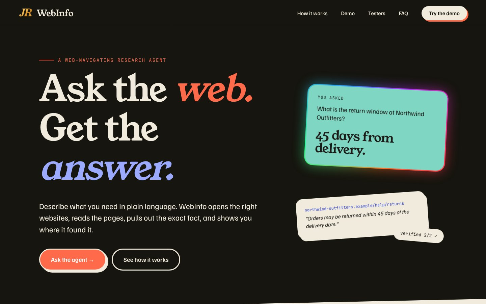
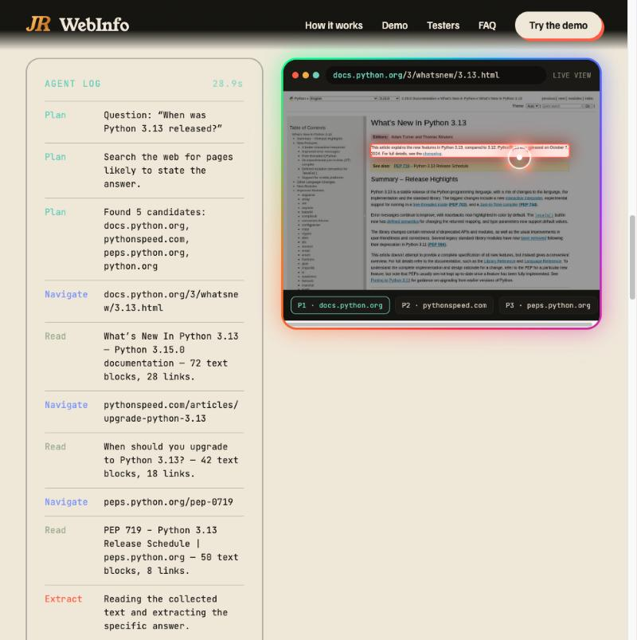
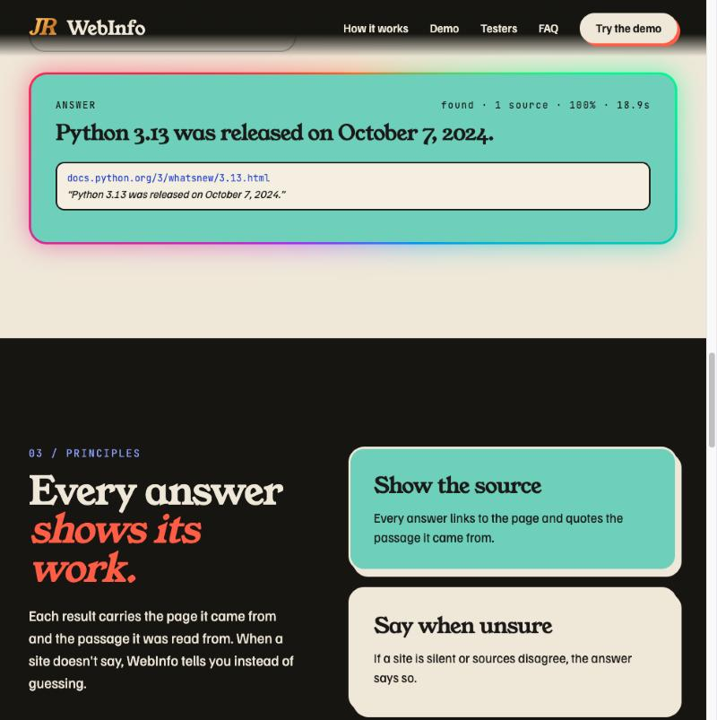

<div align="center">

# JR · WebInfo

### Ask the web. Get the answer.

**A web-navigating research agent.** Describe what you need in plain language. WebInfo opens the right websites, reads the pages,
pulls out the exact fact, and shows you where it found it, with a live view of its own browser and a breathing gaming cursor.

**Live:** http://136.113.27.193 &nbsp;·&nbsp; **Film:** [`docs/architecture.html`](docs/architecture.html) &nbsp;·&nbsp; **Event contract:** [`docs/EVENTS.md`](docs/EVENTS.md)



</div>

---

## The film: one question, start to finish

<div align="center">
<a href="docs/architecture.html"></a>
</div>

| | Chapter | What happens | Code |
|---|---|---|---|
| 01 | **Ask** | The browser opens one live stream: `GET /api/ask` | `frontend/index.html`, `backend/app/main.py` |
| 02 | **Search** | Tavily finds candidate pages (1 credit, cached 24 h) | `backend/app/search.py` |
| 03 | **Navigate** | Headless Chromium opens real pages, one tab at a time, robots rules respected; every screen streams back with the cursor | `backend/app/browser.py` |
| 04 | **Extract** | One Gemini Flash-Lite call reads numbered page blocks and returns JSON with verbatim quotes | `backend/app/llm.py`, `backend/app/agent.py` |
| 05 | **Verify** | The agent re-opens the source, scrolls to the quote and highlights the passage | `backend/app/browser.py` |
| 06 | **Answer** | A cited answer streams to the screen and is cached in Postgres, so repeats cost nothing | `backend/app/db.py` |
| 07 | **Deploy** | GitHub → Cloud Shell → a free-tier e2-micro running Docker | `deploy/*`, `docker-compose.yml` |

Prefer video? [`docs/architecture.mp4`](docs/architecture.mp4). Open [`docs/architecture.html`](docs/architecture.html) in a browser for the interactive cut: scrub the timeline, drag to fly the camera, and click any repo file to jump to its shot.

---

## What a run looks like

<table><tr>
<td width="50%"></td>
<td width="50%"></td>
</tr><tr>
<td><sub>Agent log on the left; the agent's own browser on the right, with the breathing cursor and the evidence box on the source page.</sub></td>
<td><sub>The answer with its quoted passage and a link to the page it came from. Real run: 18.9 s.</sub></td>
</tr></table>

```
question ─► Postgres cache (12 h)  ── hit ──► answer, zero API calls
         ─► Tavily search (1 credit, cached 24 h)
         ─► robots.txt check ─► Chromium visits the top 3 sites ──► screenshots + cursor events ─► UI
         ─► Gemini Flash-Lite: answer + verbatim citations (1 call; search snippets as fallback evidence)
         ─► not found? follow the best link (1 more call)
         ─► re-open the source, scroll to the quote, highlight ─► answer
```

**Stack:** FastAPI · Playwright/Chromium · Gemini REST (2-key rotation) · Tavily · Postgres 16 · Docker Compose · GCP e2-micro
**Design:** Young Serif · Familjen Grotesk · JetBrains Mono, three moods (Paper, Midnight, Ocean), three type sets and three motion levels, switchable in the site footer.

---

## Live deployment
| | |
|---|---|
| URL | http://136.113.27.193 |
| VM | `webinfo-vm` · e2-micro · us-central1-a · 30 GB pd-standard · Debian 12 · 2 GB swap |
| Containers | `webinfo-api-1` (FastAPI + Chromium), `webinfo-db-1` (Postgres 16) |
| Add / rotate API keys | SSH to the VM → `sudo bash /opt/webinfo/deploy/set-keys.sh` |

The external IP is ephemeral: it changes if the VM is stopped and started again.

## Free-tier guard rails
| Limit | Default | Where |
|---|---|---|
| Gemini calls / key / day | 400 (free Flash-Lite ≈ 500) | `GEMINI_DAILY_CAP` |
| Gemini spacing per key | 4 s | `GEMINI_MIN_INTERVAL_S` |
| Tavily credits / month | 900 (free = 1,000) | `TAVILY_MONTHLY_CAP` |
| Questions / IP / hour | 15 | `PER_IP_HOURLY_LIMIT` |
| Gemini calls per question | 1–2 | `MAX_HOPS` |
| Browsing time per question | 45 s, then answer from what was read | `BROWSE_BUDGET_S` |
| Repeat question | 0 API calls (Postgres cache) | `ANSWER_CACHE_HOURS` |

Model: a blank `GEMINI_MODEL` auto-selects the newest Flash-Lite via ListModels (a free call). A 429 benches a key for 60 s and rotates to the other.
Keys are never stored in the database, only a 10-character hash fingerprint for the quota ledger.
The browser refuses private and metadata IPs (SSRF guard), skips bot walls and error pages, honours robots.txt, and page text is treated as untrusted data in the prompt.

## Deploy on GCP (free tier)
1. Open **Cloud Shell** in the console, then:
   ```bash
   git clone https://github.com/jayendravarma04/webinfo && cd webinfo   # private repo: use a GitHub token when prompted
   gcloud config set project <YOUR_PROJECT_ID>
   bash deploy/create-vm.sh
   ```
2. Wait about 3 minutes, then SSH in and install:
   ```bash
   gcloud compute ssh webinfo-vm --zone us-central1-a
   sudo git clone git@github.com:jayendravarma04/WebInfo.git /opt/webinfo   # read-only deploy key
   cd /opt/webinfo && sudo bash deploy/install.sh
   sudo bash deploy/set-keys.sh      # hidden prompts for Gemini ×2 + Tavily
   ```
3. Open `http://<EXTERNAL_IP>/`. Updates: `sudo bash deploy/update.sh`.

Cost: an e2-micro with a 30 GB pd-standard disk in us-central1 is Always Free. Postgres runs in Docker on the same VM (Cloud SQL has no free tier).
The VM's external IPv4 may bill a few dollars a month, covered by trial credit. Stop the VM when you're not demoing: `gcloud compute instances stop webinfo-vm --zone us-central1-a`.

## Local dev and tests
```bash
cd backend && pip install -r requirements.txt && playwright install chromium
DATABASE_URL=postgresql://... python -m tests.e2e_mock     # offline end-to-end test: real browser, fake Tavily/Gemini
DATABASE_URL=postgresql://... python -m tests.ui_preview   # the full site on :8077 against the fake APIs
```

## Repo map
| Path | Role |
|---|---|
| `frontend/index.html` | The WebInfo site from the design, with the live demo, agent log, live browser view and gaming cursor |
| `frontend/fonts.css`, `frontend/fonts/` | Young Serif, Familjen Grotesk and JetBrains Mono, self-hosted |
| `backend/app/main.py` | FastAPI: `/api/ask` event stream, `/api/health`, `/api/usage`, `/api/history`, rate limit |
| `backend/app/agent.py` | The loop: cache, search, browse, extract, follow, verify |
| `backend/app/browser.py` | Playwright navigator: robots.txt, SSRF guard, bot-wall detection, screenshots, cursor events, highlight |
| `backend/app/llm.py` | Gemini REST client: model auto-pick, key rotation, pacing, daily caps |
| `backend/app/search.py` | Tavily search with cache and monthly cap |
| `backend/app/db.py` | Postgres schema, cache, quota ledger, run history |
| `backend/app/config.py` | Every limit, set from `.env` |
| `docs/architecture.html` | The cinematic 3D architecture film (three.js, bloom, particle streams) |
| `docs/EVENTS.md` | Server-sent event contract the UI renders |
| `deploy/` | `create-vm.sh`, `startup.sh`, `install.sh`, `set-keys.sh`, `update.sh` |
